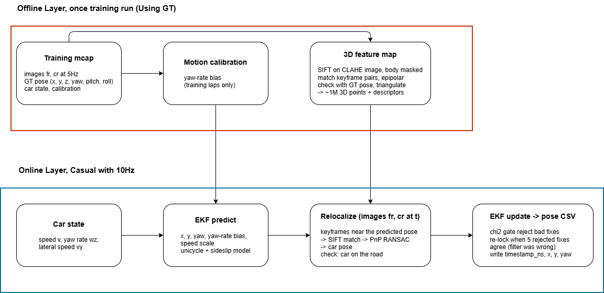
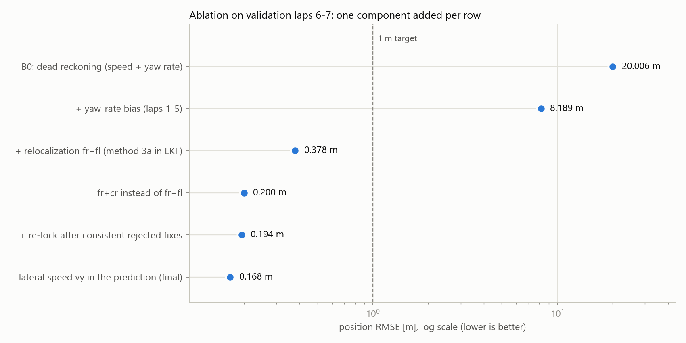
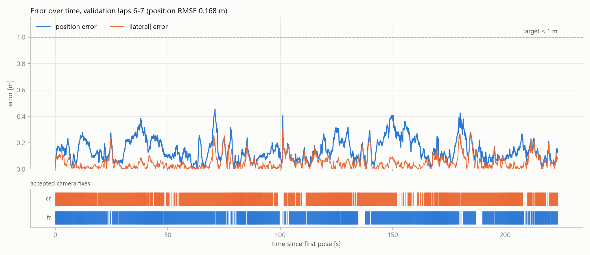
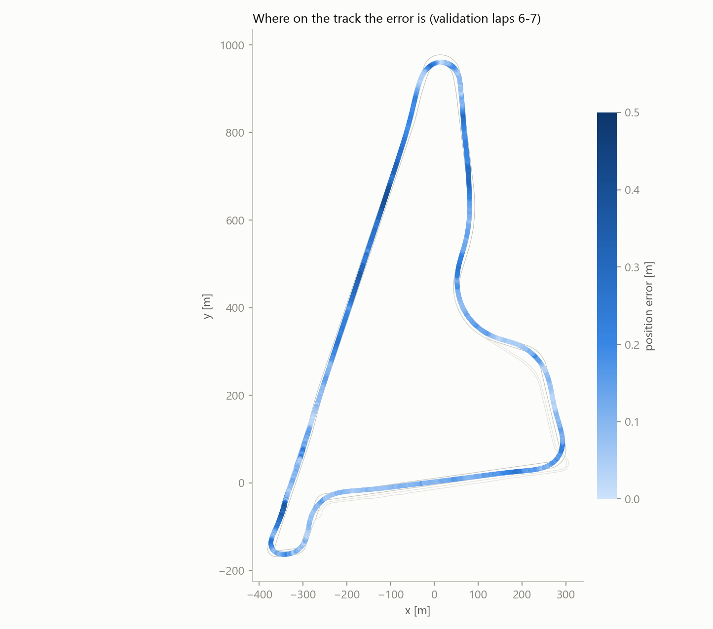
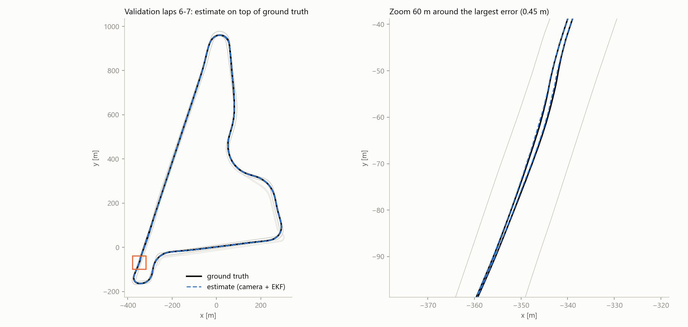

# Camera-only localization of a race car — Yas Marina, Constructor Labs challenge

**Result on our validation laps 6-7 (never used for training or tuning): position RMSE 0.168 m,
lateral 0.071 m, yaw 0.089°, 100 % of poses within 0.5 m, coverage 100 %, causal, 10 Hz.**

Data: the organisers' training run `c0_2026-10-13_22-53-42_camloc_0.mcap` (7 cameras at 10 Hz, car state,
`/tf` ground truth, 1 194 s, 7 laps + pit lane).

## Method in one picture

 

INTRO method **3a** (the training run becomes a 3D feature map, relocalization by PnP) inside
method **4** (a filter that joins car motion and map fixes):

- **Offline, once, training run** (ground truth allowed): SIFT features of the cameras `fr` and `cr`
  (5 Hz keyframes, contrast-enhanced with CLAHE, car body masked) are matched between keyframes 0.6 s and
  0.2 s apart, checked against the epipolar line of the **known GT poses** and triangulated: about 1.3 M 3D
  points with descriptors. The yaw-rate bias of the car state is estimated on the same laps.
- **Online, causal, every image set (10 Hz)**: an EKF predicts the pose from speed, yaw rate and lateral
  speed of the car state (stamps ≤ t). The keyframes near the **predicted** pose give candidate 3D points;
  SIFT matches + PnP RANSAC give the car pose per camera; a chi-square gate rejects bad fixes. If five
  rejected fixes in a row agree with each other, the filter is the one that is wrong (lock-out): its
  uncertainty is inflated and the fix is accepted. One pose is written per image set.

Inputs at inference: images, calibration (`camera_info`, `/tf_static`), track borders (only for the road
height under the car), speed / yaw rate / lateral speed of `state_estimation`, the first pose.
Never: `/tf`, position / orientation / s, n of `state_estimation`
([config/state_columns.yaml](config/state_columns.yaml), enforced by `tools_team/state_io.load_state`).

## Run

Needs Python 3.10, CPU only (no GPU), about 1.5 GB of free disk next to the 7.5 GB training mcap.
Tested on Windows 11 in PowerShell; every command is one line and works the same in bash.

**1. Install** (from the repository root)

```bash
python -m venv .venv
.venv\Scripts\Activate.ps1           # Windows PowerShell;  Linux / macOS: source .venv/bin/activate
pip install -r requirements.txt
```

Copy the training run to `data/c0_2026-10-13_22-53-42_camloc_0.mcap` (create `data/`). It is needed for every run,
also for the hidden test run: the 3D map and the yaw-rate bias are built from it.

**2. Hidden test run → submission CSV**

```bash
python run.py --final --test-mcap <test.mcap> --first-pose <timestamp_ns>,<x>,<y>,<yaw> --out out/submission.csv
```

- `--first-pose`: the first pose of the run, given by the organisers (the only ground truth used). A CSV with the
  header `timestamp_ns,x,y,yaw` works too: `--first-pose-csv <file>` (its first row is used).
- `--final`: map and bias from the whole training run (7 laps + pit lane).
- Output `out/submission.csv`: `timestamp_ns,x,y,yaw`, one pose per image set (10 Hz, `header.stamp` of the images).
- First run about 1 h (map from the whole run); the map is cached, later runs only localize (about 2.7 s of compute
  per second of data).

**3. Reproduce our validation score** (map + bias from laps 1-5, scored on laps 6-7)

```bash
python tools/extract_gt.py data/c0_2026-10-13_22-53-42_camloc_0.mcap data/gt.csv
python tools_team/extract_static.py data/c0_2026-10-13_22-53-42_camloc_0.mcap data/static.json
python tools_team/track_and_laps.py data/static.json data/gt.csv data/laps.csv out/track_gt.png
python tools_team/crop_gt.py data/gt.csv data/laps.csv 6 7 --out data/gt_val.csv
python run.py --test-mcap data/c0_2026-10-13_22-53-42_camloc_0.mcap --first-pose-csv data/gt_val.csv --out out/submission_val.csv --eval-gt data/gt_val.csv
```

The first four lines only cut out the ground truth of laps 6-7. `run.py` reads its first row (first pose) and its
last row (end of the time window), never the poses in between; `--eval-gt` then prints the `evaluate.py` output
shown under Results (0.168 m). About 50 min the first time.

`run.py` runs every stage and caches its outputs in `data/` and `config/` (`--rebuild` recomputes them):
GT / static / car state extraction → map images → laps → car-body masks → yaw-rate bias → 3D map →
localization. The output is deterministic (fixed RANSAC seed, one OpenCV object set per thread): two runs
give byte-identical CSV files, also a `--rebuild` from a clean checkout (same maps, same CSV hash).

Other entry points: `python loc/ablation.py` (table below), `python loc/plots.py` (figures),
`python loc/video.py` (video of the path against ground truth),
`python loc/test_map.py reloc --map data/map/laps1-4 --lap 5` (per-frame relocalization check).

## Results

Validation = laps 6 and 7 (223.5 s, lap 7 is the fastest lap of the run, 41 m/s). Map and bias come from
laps 1-5. **Every design choice** (cameras, lateral speed, re-lock rule, thresholds) was made on lap 5 with a
map from laps 1-4; laps 6-7 were only scored. Scripts refuse maps / calibrations that contain the scored laps.

`tools/evaluate.py data/gt_val.csv out/submission_val.csv`:

```
coverage (1 s bins)    100.0 %   (>= 90 % to be ranked)
position RMSE  [m]     0.168   <- SCORE (lower is better)
position median/p95    0.124 / 0.306
lateral RMSE   [m]     0.071
longitudinal RMSE [m]  0.152
yaw RMSE     [deg]     0.089
within 0.25 m          87.6 %
within 0.50 m          100.0 %
within 1.00 m          100.0 %
```

The GT itself is ~0.1 m / 0.2° accurate (organisers' README), so these errors are at the level of the reference.

### Ablation (same code and data, one component added per row; `python loc/ablation.py`)

| configuration (validation laps 6-7) | position RMSE | lateral | longitudinal | median / p95 | yaw RMSE | within 1 m |
|---|---|---|---|---|---|---|
| B0: dead reckoning (speed + yaw rate) | **20.006 m** | 14.888 m | 13.364 m | 16.143 / 34.540 m | 2.510° | 1.5 % |
| + yaw-rate bias (laps 1-5) | **8.189 m** | 5.649 m | 5.928 m | 7.204 / 13.860 m | 0.868° | 1.4 % |
| + relocalization fr+fl (method 3a in EKF) | **0.378 m** | 0.269 m | 0.265 m | 0.159 / 0.840 m | 0.108° | 95.8 % |
| fr+cr instead of fr+fl | **0.200 m** | 0.121 m | 0.160 m | 0.145 / 0.358 m | 0.088° | 100.0 % |
| + re-lock after consistent rejected fixes | **0.194 m** | 0.115 m | 0.156 m | 0.145 / 0.350 m | 0.088° | 100.0 % |
| + lateral speed vy in the prediction (final) | **0.168 m** | 0.071 m | 0.152 m | 0.124 / 0.306 m | 0.089° | 100.0 % |



### Where the error is





### Runtime

244 ms per image set (2 cameras, p95 273 ms) — 2.4× slower than real time at 10 Hz.
Hardware: AMD Ryzen 9 8945HX (16 cores / 32 threads), 32 GB RAM, Windows 11, Python 3.10; the GPU
(RTX 5070 Laptop) is not used. The two cameras run in parallel threads; SIFT (~0.1 s per image) dominates.

## What failed, and what we learned

| attempt | numbers | lesson |
|---|---|---|
| Method 2, matching the map borders to image edges ([archive/method2](archive/method2)) | single-frame lateral error ±0.7-1 m, EKF 51.8 m vs 41.3 m without camera | 6-8 parallel bright lines at the track edge, camera only 0.35 m above the road: 0.5 m shift = 5 px |
| Refining camera angles on edge cost | fl -4.6° (borders in the sky), cl +6.6° | the cost can be lowered by pushing points out of view; yaw is unobservable for side cameras |
| Gate lock-out | lap 5: 95 % of the squared error in one 10 s stretch, 73 correct fixes rejected | an over-confident filter is worse than a noisy measurement → consensus re-lock (lap 5: 0.84 → 0.28 m) |
| Front cameras fl + fr | lap 5 0.87 m vs 0.84 m with fr + cr; blurred section 1.40 m vs 0.31 m | the wide side camera sees close structure (walls, fences) with strong parallax where the front one blurs |
| Rear camera r | +1.4 m along-track bias, 41 % fixes | likely a ~47 ms stamp offset (at 30 m/s, 10 ms = 0.3 m) |
| No lateral speed | tight corners: drift over 3 s 1.55 m → 0.66 m with `vy_mps` | sideslip matters exactly where the camera loses track |
| Multi-threading | two runs gave different CSVs | OpenCV CLAHE / SIFT / matcher objects are not thread-safe → one set per thread, fixed seed |

## Limits

- The map comes from the same session; the hidden run may be faster or differently lit.
- Map coverage matters: the 86 s pit / out-lap before lap 1 is not in the laps 1-5 map; there only 29 of
  863 frames get a fix and the error grows to ~4 m before the car rejoins the mapped track (2.7 m RMSE).
  `--final` therefore builds the map from the whole training run.
- Not real time yet (244 ms per image set on CPU). No pre-trained model, no external data.

## Repository

| path | content |
|---|---|
| `run.py` | the one command |
| `loc/` | `vision.py` (camera geometry, features), `build_map.py`, `reloc.py` (PnP), `ekf.py`, `run_reloc.py` (causal loop), `calib_motion.py`, `ablation.py`, `plots.py`, `video.py`, `test_map.py` (dev checks) |
| `tools/` | organisers' `extract_gt.py`, `evaluate.py` |
| `tools_team/` | extraction from the mcap, laps, masks, allowed state columns, baseline B0 |
| `archive/method2/` | the rejected border-matching method |
| `archive/tests/` | a tiny fake mcap with the same topics, to smoke-test the extraction scripts (not used by `run.py`) |
